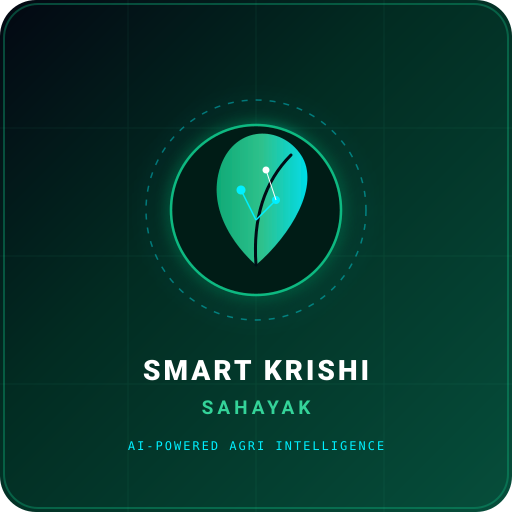
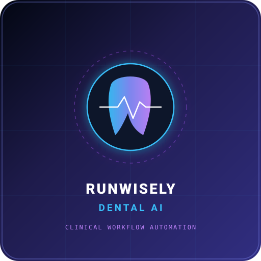
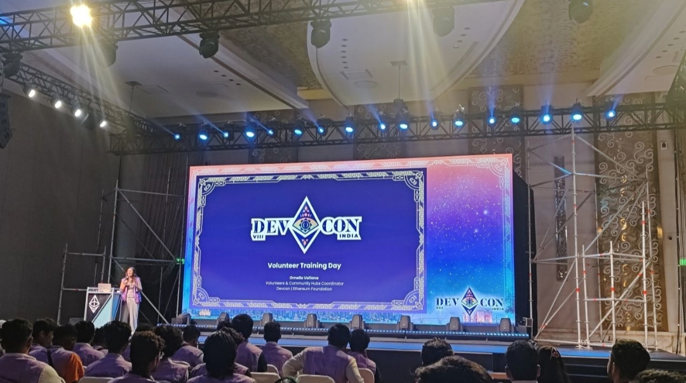
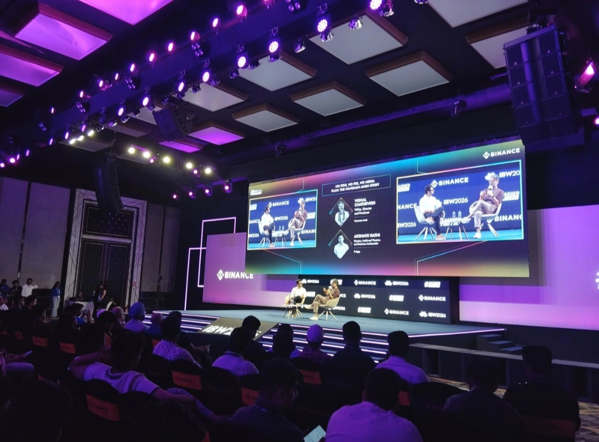
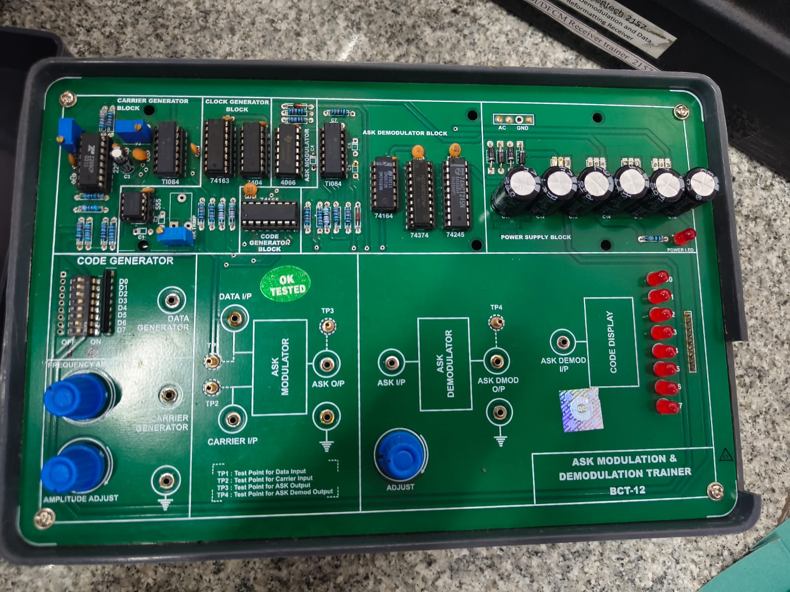

<div align="center">

<!-- HERO BANNER -->


<!-- CAPSULE RENDER HEADER -->


<!-- ANIMATED TYPING HUD -->
<a href="https://github.com/ABHISHEK-DBZ">
  
</a>

<br/><br/>

<!-- SYSTEM STATUS & CORE METRICS -->
<p align="center">
  
  
  
  
</p>

<p align="center">
  <a href="https://github.com/ABHISHEK-DBZ">
    
  </a>
  <a href="https://github.com/ABHISHEK-DBZ?tab=followers">
    
  </a>
  <a href="https://github.com/ABHISHEK-DBZ?tab=repositories">
    
  </a>
  
</p>

</div>

---

## ⚡ 01 // SYSTEM OPERATOR: ABOUT ME

<table>
<tr>
<td width="64%" valign="top">

### `> EXECUTE BIO_PROTOCOL // ABHISHEK JHA`

> **"Make technology useful, not just impressive."**

I am an **AI-focused product builder, founder, and developer** passionate about building intelligent applications, AI-powered products, and technology-driven solutions that solve tangible problems.

Currently pursuing **VLSI (Very Large Scale Integration) Engineering** in India — bridging the gap between semiconductor hardware architecture, edge compute, and modern frontier AI systems.

I believe in **end-to-end craftsmanship**: taking ideas from rough zero-stage napkin concepts to rock-solid software architecture, resilient backends, agentic workflows, and shipped production applications.

#### 🧠 CORE COGNITIVE FOCUS & INTERESTS
- 🤖 **Artificial Intelligence & Generative AI** — Advanced prompt reasoning, multi-modal synthesis, and synthetic datasets
- ⚡ **Large Language Models & RAG** — Hybrid vector/sparse retrieval, chunking strategies, reranking, and citation guarantees
- 🧬 **Agentic AI & Multi-Agent Workflows** — Autonomous problem decomposition, reflection loops, and tool orchestration
- 🕸️ **Knowledge Graphs** — Graph RAG, semantic ontologies, and relational context augmentation
- 🔐 **Local LLM Inference** — Privacy-preserving edge deployment, quantization (GGUF/AWQ), and zero-leak architectures
- ⚙️ **Backend Engineering** — High-throughput asynchronous APIs, event-driven pipelines, and distributed data systems
- 📐 **Software Architecture** — Deep module design, robust error recovery, and production scalability

```bash
user@abhishek-dbz:~$ systeminfo --target "AI Product Ecosystem"
[+] MISSION    : Build intelligent software that creates real economic value
[+] OPERATOR   : Abhishek Jha (@ABHISHEK-DBZ)
[+] SPECIALTY  : Full-Cycle AI Product Engineering & System Architecture
[+] STATUS     : Shipping code daily 🚀
```

</td>
<td width="36%" align="center" valign="top">


### **ABHISHEK JHA**
<sub>AI PRODUCT BUILDER · FOUNDER · DEVELOPER</sub>

<br/>


<br/><br/>


<sub>*Fueled by relentless curiosity, Saiyan grit, and clean code.*</sub>

</td>
</tr>
</table>

---

## 🚀 02 // PROJECT SHOWCASE: THE BUILD MATRIX

<div align="center">
  <p><em>Enterprise-grade AI products, voice-first utilities, and domain-specific intelligence architectures.</em></p>
</div>

<table>
<tr>
<!-- LEXACORE AI -->
<td width="50%" valign="top">

<div align="center">
  
</div>

### ⚖️ LEXACORE AI
> **AI-Powered Legal Intelligence & Contract Compliance**

A cutting-edge legal intelligence platform engineered to eliminate bureaucratic cognitive drag in enterprise legal workflows.

- **Contract Intelligence**: Automated multi-clause risk scoring, anomaly detection, and cross-jurisdictional compliance checks.
- **Document Analysis & Search**: Hybrid dense-sparse RAG pipeline over statutes, contracts, and case precedents with pinpoint citations.
- **Privacy-Conscious Architecture**: Zero-retention data pipelines ensuring complete client confidentiality.

<br/>

```
TECH STACK:
Python · FastAPI · Supabase · PostgreSQL · LangChain · LlamaIndex · Docker
```

<p align="center">
  <a href="https://github.com/ABHISHEK-DBZ/lexacore-ai">
    
  </a>
  
</p>

</td>

<!-- KHATACOPILOT -->
<td width="50%" valign="top">

<div align="center">
  
</div>

### 🎙️ KHATACOPILOT
> **Voice-First AI Bookkeeping for Small Businesses**

An intelligent bookkeeping companion empowering small business merchants to record transactions naturally through voice.

- **Multilingual Voice Interaction**: Speech-to-transaction parsing supporting regional accents and vernacular speech patterns.
- **Offline-First Architecture**: High-speed local database operations ensuring uninterrupted bookkeeping without an active internet connection.
- **Automated Ledger Auditing**: Smart cashflow summaries, credit-debit reconciliations, and instant customer balance notifications.

<br/>

```
TECH STACK:
Flutter · Dart · SQLite · Whisper AI · FastAPI · Local LLM Inference
```

<p align="center">
  <a href="https://github.com/ABHISHEK-DBZ/khatacopilot">
    
  </a>
  
</p>

</td>
</tr>

<tr>
<!-- SMART KRISHI SAHAYAK -->
<td width="50%" valign="top">

<div align="center">
  
</div>

### 🌾 SMART KRISHI SAHAYAK
> **AI-Powered Precision Agricultural Assistant**

An intelligent agricultural co-pilot designed to augment farming decisions with computer vision and predictive agronomy insights.

- **Crop Disease Detection**: Edge-optimized computer vision models identifying leaf pathognomonic symptoms in seconds.
- **Localized Weather Intelligence**: Micro-climate telemetry alerting farmers to precipitation windows and pest vulnerability periods.
- **Agricultural Decision Engine**: Dynamic recommendations for fertilizer dosages, soil enrichment, and market price advisories.

<br/>

```
TECH STACK:
TensorFlow · PyTorch · Flutter · FastAPI · Computer Vision · IoT
```

<p align="center">
  <a href="https://github.com/ABHISHEK-DBZ/smart-krishi-sahayak">
    
  </a>
  
</p>

</td>

<!-- RUNWISELY DENTAL -->
<td width="50%" valign="top">

<div align="center">
  
</div>

### 🦷 RUNWISELY DENTAL
> **AI-Assisted Dental Workflow & Narrative Automation**

An intelligent clinical documentation copilot eliminating administrative overhead for modern dental practices.

- **Intelligent Intake Processing**: Automated extraction of clinical records, medical history, and procedural notes.
- **Missing-Information Detection**: Pre-submission heuristic audits catching missing billing codes and unsigned consent fields.
- **Clinical Narrative Synthesis**: Automated drafting of comprehensive treatment narratives for clinical review and insurance claims.

<br/>

```
TECH STACK:
Python · Document AI · FastAPI · OCR · NLP Pipelines · HIPAA Compliant
```

<p align="center">
  <a href="https://github.com/ABHISHEK-DBZ/runwisely-dental">
    
  </a>
  
</p>

</td>
</tr>
</table>

---

## 🛠️ 03 // TECHNOLOGY ARSENAL: SYSTEM CAPABILITIES

<div align="center">
  <p><em>Multidisciplinary stack spanning low-level system languages, deep learning frameworks, scalable backends, and responsive clients.</em></p>
</div>

### `> CORE RUNTIME ENVIRONMENTS // PROGRAMMING LANGUAGES`
<p align="center">
  
</p>
<p align="center">
  <code>PYTHON</code> · <code>C</code> · <code>C++</code> · <code>JAVA</code> · <code>JAVASCRIPT</code> · <code>TYPESCRIPT</code> · <code>DART</code> · <code>GO</code>
</p>

<br/>

### `> NEURAL COMPUTE & ARTIFICIAL INTELLIGENCE`
<p align="center">
  
</p>
<p align="center">
  
  
  
  
  
</p>

<br/>

### `> BACKEND ARCHITECTURE & DATA SYSTEMS`
<p align="center">
  
</p>
<p align="center">
  <code>FASTAPI</code> · <code>DJANGO</code> · <code>NODE.JS</code> · <code>POSTGRESQL</code> · <code>SUPABASE</code> · <code>SQLITE</code> · <code>REDIS</code>
</p>

<br/>

### `> USER INTERFACE & MOBILE CLIENTS`
<p align="center">
  
</p>
<p align="center">
  <code>REACT</code> · <code>FLUTTER</code> · <code>HTML5</code> · <code>CSS3</code> · <code>TAILWIND CSS</code>
</p>

<br/>

### `> DEVELOPER TOOLCHAIN, DEVOPS & CLOUD INFRASTRUCTURE`
<p align="center">
  
</p>
<p align="center">
  <code>GIT</code> · <code>GITHUB ACTIONS</code> · <code>DOCKER</code> · <code>VS CODE</code> · <code>LINUX</code> · <code>AWS</code> · <code>FIREBASE</code> · <code>VERCEL</code>
</p>

---

## 📊 04 // GITHUB CONTROL ROOM: TELEMETRY DASHBOARD

<div align="center">
  <p><em>Real-time developer telemetry, repository distribution, and continuous contribution stream.</em></p>
</div>

<div align="center">

<!-- STATS & TOP LANGS ROW -->
<table>
<tr>
<td width="50%" align="center" valign="middle">

#### `> DEVELOPER ACTIVITY METRICS`
<a href="https://github.com/ABHISHEK-DBZ">
  
</a>

</td>
<td width="50%" align="center" valign="middle">

#### `> LANGUAGE BREAKDOWN`
<a href="https://github.com/ABHISHEK-DBZ">
  
</a>

</td>
</tr>
</table>

<!-- PROFILE SUMMARY DASHBOARD -->
<p align="center">
  
</p>

</div>

### 🐍 05 // CONTINUOUS CONTRIBUTION STREAM

<div align="center">

<p><em>Autonomous contribution snake traversing the commit graph in real time via GitHub Actions.</em></p>

<!-- CONTRIBUTION SNAKE -->
<picture>
  <source media="(prefers-color-scheme: dark)" srcset="https://raw.githubusercontent.com/ABHISHEK-DBZ/ABHISHEK-DBZ/output/github-contribution-grid-snake-dark.svg">
  <source media="(prefers-color-scheme: light)" srcset="https://raw.githubusercontent.com/ABHISHEK-DBZ/ABHISHEK-DBZ/output/github-contribution-grid-snake.svg">
  
</picture>

<p align="center">
  <sub>Generated automatically via <code>.github/workflows/snake.yml</code> using Platane/snk</sub>
</p>

</div>

---

## 📷 06 // MY JOURNEY: PHYSICAL CHRONICLES

<div align="center">
  <p><em>From hackathons and volunteer summits to silicon electronics laboratories and midnight building sprints.</em></p>
</div>

<table>
<tr>
<!-- DEVCON EVENT -->
<td width="50%" valign="top">



<h4 align="center">🌐 DEVCON INDIA // VOLUNTEER TRAINING</h4>
<p align="center">
  <sub>Active community volunteer and contributor at Devcon India. Passionate about empowering builder communities and developer knowledge sharing.</sub>
</p>

</td>

<!-- TECH EVENT -->
<td width="50%" valign="top">



<h4 align="center">⚡ TECH & DEVELOPER ECOSYSTEM</h4>
<p align="center">
  <sub>Immersed in cutting-edge developer summits, startup founder circles, and collaborative tech meetups across India.</sub>
</p>

</td>
</tr>

<tr>
<!-- ELECTRONICS LAB -->
<td width="50%" valign="top">



<h4 align="center">🔬 VLSI & HARDWARE ENGINEERING LAB</h4>
<p align="center">
  <sub>Hands-on experimentation with silicon design, digital logic, VLSI circuits, and hardware architectures that power tomorrow's AI accelerators.</sub>
</p>

</td>

<!-- BUILDER WORKSPACE -->
<td width="50%" valign="top">


<h4 align="center">💻 THE COMMAND CENTER // BUILD WORKSPACE</h4>
<p align="center">
  <sub>The engine room where architecture blueprints turn into working prototypes, robust APIs, and scalable production software.</sub>
</p>

</td>
</tr>
</table>

---

## 🔮 07 // EXPLORATION RADAR & HORIZONS

```
┌──────────────────────────────────────────────────────────────────────────────┐
│ [01] AGENTIC MULTI-MODAL REASONING ARCHITECTURES                             │
│      Deep investigation into self-correcting agent chains and task graphs.   │
├──────────────────────────────────────────────────────────────────────────────┤
│ [02] HARDWARE-AWARE QUANTIZATION & EDGE SILICON INFERENCE                    │
│      Bridging VLSI circuit efficiency with low-bit on-device LLM compute.    │
├──────────────────────────────────────────────────────────────────────────────┤
│ [03] ENTERPRISE GRAPH-AUGMENTED GENERATION (GRAPH-RAG)                       │
│      Synthesizing dense vector similarity with deterministic knowledge nets. │
└──────────────────────────────────────────────────────────────────────────────┘
```

---

## 🌐 08 // CONNECT WITH THE BUILDER

<div align="center">

<p><em>Have an ambitious idea, high-impact AI project, or want to collaborate? Let's connect.</em></p>

<p align="center">
  <a href="https://github.com/ABHISHEK-DBZ" target="_blank">
    
  </a>
  <a href="https://linkedin.com/in/" target="_blank">
    
  </a>
  <a href="https://x.com/" target="_blank">
    
  </a>
  <a href="mailto:contact@abhishekjha.dev">
    
  </a>
</p>

<br/>

<!-- ANIMATED CLOSING MOTTO -->


<br/><br/>

### `BUILD WITH PURPOSE. SHIP WITH PRIDE.`

<!-- FOOTER WAVING WAVE -->


<p align="right">
  <a href="#-abhishek-jha">
    
  </a>
</p>

</div>
