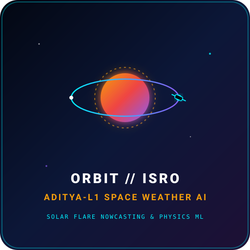
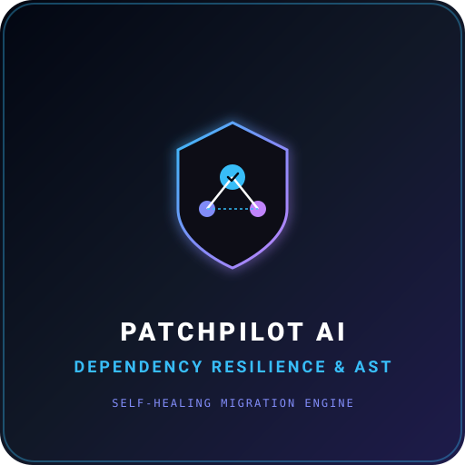
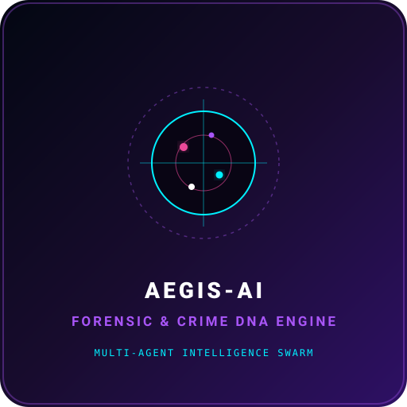
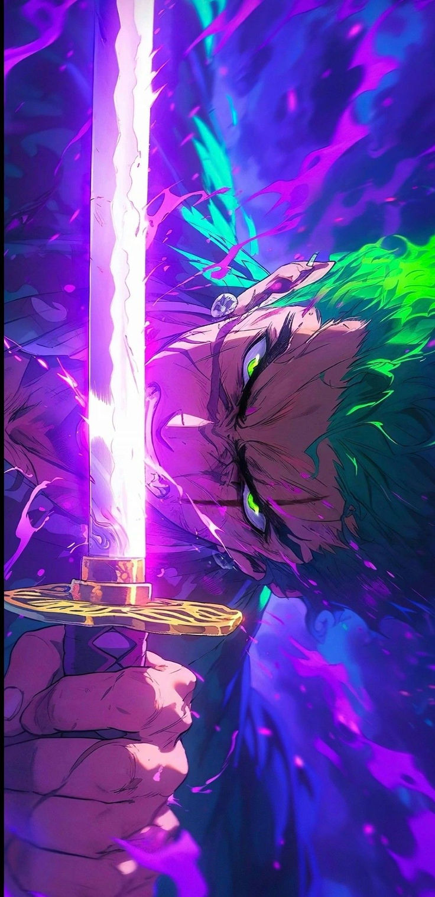

<div align="center">

<!-- HERO BANNER -->


<!-- CAPSULE RENDER HEADER -->


<!-- ANIMATED CYBER SCANNER DIVIDER -->


<!-- ANIMATED TYPING HUD -->
<a href="https://github.com/ABHISHEK-DBZ">
  
</a>

<br/><br/>

<!-- SYSTEM STATUS & CORE TELEMETRY BADGES -->
<p align="center">
  <a href="https://github.com/Quantum-Ark" target="_blank">
    
  </a>
  <a href="https://abhishek-jha-portfolio.surge.sh/" target="_blank">
    
  </a>
  <a href="https://orcid.org/0009-0000-7724-1273" target="_blank">
    
  </a>
  
</p>

<p align="center">
  <a href="https://github.com/ABHISHEK-DBZ">
    
  </a>
  <a href="https://github.com/ABHISHEK-DBZ?tab=followers">
    
  </a>
  <a href="https://github.com/ABHISHEK-DBZ?tab=repositories">
    
  </a>
  
</p>

</div>

---

## ⚡ 01 // SYSTEM OPERATOR: ABOUT ME

<table>
<tr>
<td width="64%" valign="top">

### `> EXECUTE BIO_PROTOCOL // ABHISHEK JHA`

> **"Make technology useful, not just impressive."**

I am an **AI Product Builder, Founder, and VLSI Systems Developer** based in **Mumbai, India** (`19.0760° N, 72.8777° E`). I lead engineering and research at **[@Quantum-Ark](https://github.com/Quantum-Ark)** and build intelligent applications, multi-agent frameworks, and domain-adapted AI architectures.

Currently studying **Electronic Engineering (VLSI)** at the **University of Mumbai** (2024–2028) — researching the intersection of semiconductor hardware logic, edge acceleration, physics-informed neural modeling, and frontier AI systems.

I believe in **end-to-end craftsmanship**: taking raw ideas from architectural blueprints to resilient backends, agentic loops, and shipped production applications that create real-world utility.

#### 🧠 CORE COGNITIVE FOCUS & HORIZONS
- 🤖 **Artificial Intelligence & Generative AI** — Advanced reasoning loops, multimodal synthesis & synthetic data
- ⚡ **Large Language Models & RAG** — Dense/sparse hybrid vector search, citation guarantees & knowledge graphs
- 🧬 **Agentic AI & Swarm Intelligence** — Autonomous multi-agent coordination, tool execution & self-reflection
- 🛰️ **Physics-Informed Deep Learning** — Solar flare prediction, space weather telemetry & scientific ML
- 🔐 **Local LLM Inference & Edge AI** — Privacy-preserving on-device compute, quantization (GGUF/AWQ)
- ⚙️ **Backend Engineering & Distributed Systems** — High-concurrency APIs, microservices & telemetry
- 📐 **Software Architecture & VLSI Logic** — Deep module design, fault-tolerant circuits & silicon logic

```bash
user@abhishek-dbz:~$ systeminfo --target "AI Product Ecosystem"
[+] OPERATOR   : Abhishek Jha (@ABHISHEK-DBZ)
[+] FOUNDER    : @Quantum-Ark // Lexacore AI // KhataCopilot
[+] LOCATION   : Mumbai, Maharashtra, India 🇮🇳 (19.0760° N, 72.8777° E)
[+] EDUCATION  : University of Mumbai — Electronic Engineering (VLSI) [2024–2028]
[+] ORCID ID   : 0009-0000-7724-1273 (https://orcid.org/0009-0000-7724-1273)
[+] PORTFOLIO  : https://abhishek-jha-portfolio.surge.sh/
[+] STATUS     : Shipping code daily 🚀
```

</td>
<td width="36%" align="center" valign="top">


### **ABHISHEK JHA**
<sub>AI PRODUCT BUILDER · FOUNDER @ QUANTUM-ARK</sub>

<br/>

<a href="https://github.com/Quantum-Ark" target="_blank">
  
</a>
<br/>


<br/><br/>


<sub>*Fueled by relentless curiosity, Saiyan grit, and clean code.*</sub>

</td>
</tr>
</table>


---

## 🚀 02 // PROJECT SHOWCASE: THE BUILD MATRIX

<div align="center">
  <p><em>Enterprise legal intelligence, space weather neural physics, voice-first fintech, and self-healing systems.</em></p>
</div>

<!-- ROW 1: LEXACORE AI & KHATACOPILOT -->
<table>
<tr>
<!-- LEXACORE AI -->
<td width="50%" valign="top">

<div align="center">
  
</div>

### ⚖️ LEXACORE AI
> **AI-Powered Legal Intelligence & Contract Compliance**

A cutting-edge legal intelligence platform engineered to eliminate bureaucratic cognitive drag in enterprise legal workflows.

- **Contract Intelligence**: Automated multi-clause risk scoring, anomaly detection, and cross-jurisdictional compliance verification.
- **Document Analysis & Search**: Hybrid dense-sparse RAG pipeline over statutory law and case precedents with pinpoint citations.
- **Privacy-Conscious Architecture**: Zero-retention data pipelines ensuring complete client-attorney confidentiality.

<br/>

```
TECH STACK:
Python · FastAPI · Supabase · PostgreSQL · LangChain · LlamaIndex · Docker
```

<p align="center">
  <a href="https://github.com/ABHISHEK-DBZ/lexacore-ai">
    
  </a>
  
</p>

</td>

<!-- KHATACOPILOT -->
<td width="50%" valign="top">

<div align="center">
  
</div>

### 🎙️ KHATACOPILOT
> **Voice-First AI Bookkeeping for Small Businesses**

An intelligent bookkeeping companion empowering small business merchants to record transactions naturally through voice.

- **Multilingual Voice Interaction**: Speech-to-transaction parsing supporting regional accents and vernacular speech patterns.
- **Offline-First Architecture**: High-speed local database operations ensuring uninterrupted bookkeeping without internet connectivity.
- **Automated Ledger Auditing**: Smart cashflow summaries, credit-debit reconciliations, and instant customer balance notifications.

<br/>

```
TECH STACK:
Flutter · Dart · SQLite · Whisper AI · FastAPI · Local LLM Inference
```

<p align="center">
  <a href="https://github.com/Quantum-Ark/khatakopilot-website">
    
  </a>
  <a href="https://github.com/Quantum-Ark/khatacopilot-releases">
    
  </a>
</p>

</td>
</tr>

<!-- ROW 2: ORBIT // ISRO & PATCHPILOT AI -->
<tr>
<!-- ORBIT // ISRO -->
<td width="50%" valign="top">

<div align="center">
  
</div>

### 🛰️ ORBIT // ISRO ADITYA-L1
> **Space Weather AI & Solar Flare Nowcasting**

A deep physics-informed scientific ML system predicting extreme solar flare events in real time using multi-band satellite telemetry from India's Aditya-L1 solar observatory.

- **Multi-Band Sensor Fusion**: Integrating real-time telemetry from Aditya-L1 SoLEXS (Soft X-ray) and HEL1OS (Hard X-ray) instruments.
- **Physics-Informed Deep Learning**: Hybrid neural architectures combining magnetohydrodynamic physics priors with temporal attention.
- **Early-Warning Space Weather Radar**: Autonomous alerts for geomagnetic storm onset, satellite drag risks, and grid vulnerability.

<br/>

```
TECH STACK:
Python · PyTorch · Aditya-L1 Telemetry · Physics-ML · FastAPI · TimescaleDB
```

<p align="center">
  <a href="https://github.com/Quantum-Ark/ISRO-hackathon">
    
  </a>
  <a href="https://github.com/ABHISHEK-DBZ/orbit">
    
  </a>
</p>

</td>

<!-- PATCHPILOT AI -->
<td width="50%" valign="top">

<div align="center">
  
</div>

### 🛡️ PATCHPILOT AI
> **AI-Powered Dependency Resilience & Migration Planner**

An autonomous developer resilience tool. *Product Principle: AI proposes. The tool verifies. The developer approves. Tests provide evidence.*

- **AST Breaking-Change Detection**: Deep semantic inspection of package version upgrades, deprecations, and breaking API signatures.
- **Automated Sandbox Verification**: Runs isolated migration experiments in containerized test runners to prove compatibility before merge.
- **Deterministic Fix Patches**: Generates precise code diffs for downstream breaking changes with zero hallucination.

<br/>

```
TECH STACK:
Python · AST Manipulation · Docker · Pytest · GitHub Actions · LLM Agents
```

<p align="center">
  <a href="https://github.com/Quantum-Ark/patchai">
    
  </a>
  <a href="https://github.com/ABHISHEK-DBZ/ancient-skull">
    
  </a>
</p>

</td>
</tr>

<!-- ROW 3: AEGIS-AI & SMART KRISHI SAHAYAK -->
<tr>
<!-- AEGIS-AI -->
<td width="50%" valign="top">

<div align="center">
  
</div>

### 🧬 AEGIS-AI // CRIME DNA ENGINE
> **All-State Engine for Forensic Intelligence & Surveillance**

An elite multi-agent cognitive intelligence platform developed for state-level criminal investigation, digital twin modeling, and pattern synthesis.

- **Criminal Digital Twins**: Behavioral modeling from historical FIR dossiers, charge sheets, and interrogation transcripts.
- **Temporal Gang Knowledge Graphs**: Uncovering latent syndicates, multi-hop financial ties, and fugitive communication networks.
- **Forensic Multi-Agent Swarm**: Specialized autonomous agents for crime simulation, anomaly discovery, and field telemetry.

<br/>

```
TECH STACK:
TypeScript · React · Python · Neo4j · Multi-Agent Swarms · FastAPI · Docker
```

<p align="center">
  <a href="https://github.com/ABHISHEK-DBZ/Aegis-AI">
    
  </a>
  
</p>

</td>

<!-- SMART KRISHI SAHAYAK -->
<td width="50%" valign="top">

<div align="center">
  
</div>

### 🌾 SMART KRISHI SAHAYAK
> **AI-Powered Precision Agricultural Assistant**

An intelligent agricultural co-pilot designed to augment farming decisions with computer vision and predictive agronomy insights.

- **Crop Disease Detection**: Edge-optimized computer vision models identifying leaf pathognomonic symptoms in seconds.
- **Localized Weather Intelligence**: Micro-climate telemetry alerting farmers to precipitation windows and pest vulnerability periods.
- **Agricultural Decision Engine**: Dynamic recommendations for fertilizer dosages, soil enrichment, and market price advisories.

<br/>

```
TECH STACK:
TensorFlow · PyTorch · Flutter · FastAPI · Computer Vision · IoT
```

<p align="center">
  <a href="https://github.com/ABHISHEK-DBZ/smart-krishi-sahayak">
    
  </a>
  <a href="https://github.com/Quantum-Ark/agro">
    
  </a>
</p>

</td>
</tr>

<!-- ROW 4: RUNWISELY DENTAL & AUTOBENCH -->
<tr>
<!-- RUNWISELY DENTAL -->
<td width="50%" valign="top">

<div align="center">
  
</div>

### 🦷 RUNWISELY DENTAL
> **AI-Assisted Dental Workflow & Narrative Automation**

An intelligent clinical documentation copilot eliminating administrative overhead for modern dental practices.

- **Intelligent Intake Processing**: Automated extraction of clinical records, medical history, and procedural notes.
- **Missing-Information Detection**: Pre-submission heuristic audits catching missing billing codes and unsigned consent fields.
- **Clinical Narrative Synthesis**: Automated drafting of comprehensive treatment narratives for clinical review and insurance claims.

<br/>

```
TECH STACK:
Python · Document AI · FastAPI · OCR · NLP Pipelines · HIPAA Compliant
```

<p align="center">
  <a href="https://github.com/ABHISHEK-DBZ/runwisely-dental">
    
  </a>
  
</p>

</td>

<!-- AUTOBENCH -->
<td width="50%" valign="top">

<div align="center">
  
</div>

### ⚡ AUTOBENCH // MULTI-AGENT SANDBOX
> **Adversarial Benchmark & Stress Testing for LLM Agents**

An elite multi-agent sandbox benchmarking suite designed to systematically evaluate autonomous LLM agents under adversarial conditions.

- **Adversarial Traps & Chaos Testing**: Injects edge cases, unexpected tool failures, and deceptive context into agent decision loops.
- **Deterministic Evaluation**: Measures tool-calling precision, reasoning efficiency, and token economics across frontier models.
- **Safety & Jailbreak Telemetry**: Rigorous security guardrails verifying that autonomous agents operate strictly within permitted bounds.

<br/>

```
TECH STACK:
Python · LLM Benchmarking · Docker Sandboxes · Asyncio · Prometheus
```

<p align="center">
  <a href="https://github.com/ABHISHEK-DBZ/Autobench">
    
  </a>
  
</p>

</td>
</tr>
</table>


---

## 🛠️ 03 // TECHNOLOGY ARSENAL: SYSTEM CAPABILITIES

<div align="center">
  <p><em>Multidisciplinary stack spanning low-level system languages, deep learning frameworks, scalable backends, and responsive clients.</em></p>
</div>

### `> CORE RUNTIME ENVIRONMENTS // PROGRAMMING LANGUAGES`
<p align="center">
  
</p>
<p align="center">
  <code>PYTHON</code> · <code>C</code> · <code>C++</code> · <code>JAVA</code> · <code>RUST</code> · <code>JAVASCRIPT</code> · <code>TYPESCRIPT</code> · <code>DART</code> · <code>GO</code>
</p>

<br/>

### `> NEURAL COMPUTE & ARTIFICIAL INTELLIGENCE`
<p align="center">
  
</p>
<p align="center">
  
  
  
  
  
  
</p>

<br/>

### `> BACKEND ARCHITECTURE & DATA SYSTEMS`
<p align="center">
  
</p>
<p align="center">
  <code>FASTAPI</code> · <code>DJANGO</code> · <code>NODE.JS</code> · <code>POSTGRESQL</code> · <code>SUPABASE</code> · <code>SQLITE</code> · <code>REDIS</code>
</p>

<br/>

### `> USER INTERFACE & MOBILE CLIENTS`
<p align="center">
  
</p>
<p align="center">
  <code>REACT</code> · <code>FLUTTER</code> · <code>HTML5</code> · <code>CSS3</code> · <code>TAILWIND CSS</code>
</p>

<br/>

### `> DEVELOPER TOOLCHAIN, DEVOPS & CLOUD INFRASTRUCTURE`
<p align="center">
  
</p>
<p align="center">
  <code>GIT</code> · <code>GITHUB ACTIONS</code> · <code>DOCKER</code> · <code>VS CODE</code> · <code>LINUX</code> · <code>AWS</code> · <code>FIREBASE</code> · <code>VERCEL</code>
</p>


---

## 📊 04 // GITHUB CONTROL ROOM: TELEMETRY DASHBOARD

<div align="center">
  <p><em>Real-time developer telemetry, repository distribution, and continuous contribution stream.</em></p>
</div>

<div align="center">

<!-- STATS & TOP LANGS ROW -->
<table>
<tr>
<td width="50%" align="center" valign="middle">

#### `> DEVELOPER ACTIVITY METRICS`
<a href="https://github.com/ABHISHEK-DBZ">
  
</a>

</td>
<td width="50%" align="center" valign="middle">

#### `> LANGUAGE BREAKDOWN`
<a href="https://github.com/ABHISHEK-DBZ">
  
</a>

</td>
</tr>
</table>

<!-- PROFILE SUMMARY DASHBOARD -->
<p align="center">
  
</p>

</div>

### 🐍 05 // CONTINUOUS CONTRIBUTION STREAM

<div align="center">

<p><em>Autonomous contribution snake traversing the commit graph in real time via GitHub Actions.</em></p>

<!-- CONTRIBUTION SNAKE -->
<picture>
  <source media="(prefers-color-scheme: dark)" srcset="https://raw.githubusercontent.com/ABHISHEK-DBZ/ABHISHEK-DBZ/output/github-contribution-grid-snake-dark.svg">
  <source media="(prefers-color-scheme: light)" srcset="https://raw.githubusercontent.com/ABHISHEK-DBZ/ABHISHEK-DBZ/output/github-contribution-grid-snake.svg">
  
</picture>

<p align="center">
  <sub>Generated automatically via <code>.github/workflows/snake.yml</code> using Platane/snk</sub>
</p>

</div>


---

## 📷 06 // MY JOURNEY: PHYSICAL CHRONICLES

<div align="center">
  <p><em>From developer summits and volunteer training to silicon laboratories and midnight building sprints.</em></p>
</div>

<table>
<tr>
<!-- DEVCON EVENT -->
<td width="50%" valign="top">


<h4 align="center">🌐 DEVCON INDIA // VOLUNTEER TRAINING</h4>
<p align="center">
  <sub>Active community volunteer and contributor at Devcon India. Passionate about empowering builder communities and developer knowledge sharing.</sub>
</p>

</td>

<!-- TECH EVENT -->
<td width="50%" valign="top">


<h4 align="center">⚡ TECH & DEVELOPER ECOSYSTEM</h4>
<p align="center">
  <sub>Immersed in cutting-edge developer summits, startup founder circles, and collaborative tech meetups across India.</sub>
</p>

</td>
</tr>

<tr>
<!-- ELECTRONICS LAB -->
<td width="50%" valign="top">


<h4 align="center">🔬 VLSI & HARDWARE ENGINEERING LAB</h4>
<p align="center">
  <sub>Hands-on experimentation with silicon design, digital logic, VLSI circuits, and hardware architectures that power tomorrow's AI accelerators.</sub>
</p>

</td>

<!-- BUILDER WORKSPACE -->
<td width="50%" valign="top">


<h4 align="center">💻 THE COMMAND CENTER // BUILD WORKSPACE</h4>
<p align="center">
  <sub>The engine room where architecture blueprints turn into working prototypes, robust APIs, and scalable production software.</sub>
</p>

</td>
</tr>
</table>


---

## 🔮 07 // EXPLORATION RADAR & HORIZONS

```
┌──────────────────────────────────────────────────────────────────────────────┐
│ [01] AGENTIC MULTI-MODAL REASONING ARCHITECTURES                             │
│      Deep investigation into self-correcting agent chains and task graphs.   │
├──────────────────────────────────────────────────────────────────────────────┤
│ [02] HARDWARE-AWARE QUANTIZATION & EDGE SILICON INFERENCE                    │
│      Bridging VLSI circuit efficiency with low-bit on-device LLM compute.    │
├──────────────────────────────────────────────────────────────────────────────┤
│ [03] ENTERPRISE GRAPH-AUGMENTED GENERATION (GRAPH-RAG)                       │
│      Synthesizing dense vector similarity with deterministic knowledge nets. │
├──────────────────────────────────────────────────────────────────────────────┤
│ [04] PHYSICS-INFORMED NEURAL TELEMETRY FOR SPACE WEATHER FORECASTING         │
│      Fusing solar magnetohydrodynamic dynamics with deep temporal models.    │
└──────────────────────────────────────────────────────────────────────────────┘
```

---

## 🌐 08 // CONNECT WITH THE BUILDER

<div align="center">

<p><em>Have an ambitious idea, high-impact AI project, or want to collaborate? Let's connect.</em></p>

<p align="center">
  <a href="https://github.com/ABHISHEK-DBZ" target="_blank">
    
  </a>
  <a href="https://github.com/Quantum-Ark" target="_blank">
    
  </a>
  <a href="https://www.linkedin.com/in/abhishek-jha-cse" target="_blank">
    
  </a>
  <a href="https://x.com/AbhishekJh46114" target="_blank">
    
  </a>
</p>

<p align="center">
  <a href="https://abhishek-jha-portfolio.surge.sh/" target="_blank">
    
  </a>
  <a href="https://orcid.org/0009-0000-7724-1273" target="_blank">
    
  </a>
  <a href="mailto:abhibro936@gmail.com">
    
  </a>
  
</p>

<br/>

<!-- ANIMATED CLOSING MOTTO -->


<br/><br/>

### `BUILD WITH PURPOSE. SHIP WITH PRIDE.`

<!-- FOOTER WAVING WAVE -->


<p align="right">
  <a href="#-abhishek-jha">
    
  </a>
</p>

</div>
